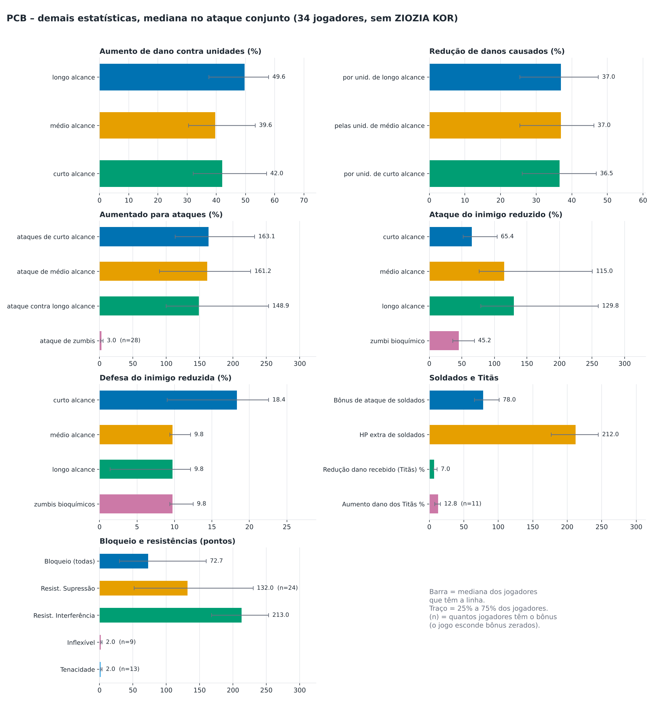

# PCB – demais estatísticas tecnológicas (34 jogadores, sem ZIOZIA KOR)

Mediana e quartis consideram só os jogadores que têm a linha (o jogo esconde bônus zerados). Na `Média da aliança` a linha ausente conta 0.

## Aumento de dano contra unidades (%)

| Estatística | Jogadores | Mediana | 25%–75% | Média (quem tem) | Média da aliança | Mín | Máx |
|---|---:|---:|---|---:|---:|---:|---:|
| Aumento de dano contra unidades de longo alcance | 34/34 | 49.6 | 37.5–58.0 | 49.9 | 49.9 | 18.0 | 87.1 |
| Aumento de dano contra unidades de médio alcance | 34/34 | 39.6 | 30.4–53.4 | 43.1 | 43.1 | 18.0 | 81.2 |
| Aumento de dano contra unidades de curto alcance | 34/34 | 42.0 | 32.0–57.2 | 47.2 | 47.2 | 18.0 | 92.5 |

## Redução de danos causados (%)

| Estatística | Jogadores | Mediana | 25%–75% | Média (quem tem) | Média da aliança | Mín | Máx |
|---|---:|---:|---|---:|---:|---:|---:|
| Redução de danos causados por unidades de longo alcance | 34/34 | 37.0 | 25.5–47.5 | 39.3 | 39.3 | 10.0 | 83.7 |
| Redução de danos causados pelas Unidades de médio alcance | 34/34 | 37.0 | 25.5–46.2 | 37.9 | 37.9 | 10.0 | 74.9 |
| Redução de danos causados por unidades de curto alcance | 34/34 | 36.5 | 26.1–46.9 | 36.4 | 36.4 | 10.7 | 60.2 |

## Aumentado para ataques (%)

| Estatística | Jogadores | Mediana | 25%–75% | Média (quem tem) | Média da aliança | Mín | Máx |
|---|---:|---:|---|---:|---:|---:|---:|
| Aumentado para Ataques de curto alcance | 34/34 | 163.1 | 113.4–232.4 | 176.9 | 176.9 | 51.6 | 354.3 |
| Aumentado para Ataque de médio alcance | 34/34 | 161.2 | 90.1–226.5 | 181.1 | 181.1 | 52.1 | 421.3 |
| Aumento de Ataque contra longo alcance | 34/34 | 148.9 | 99.9–253.4 | 182.1 | 182.1 | 58.0 | 422.0 |
| Aumentado para Ataque de zumbis bioquímicos | 28/34 | 3.0 | 1.8–5.4 | 4.9 | 4.0 | 0.6 | 25.2 |

## Ataque do inimigo reduzido (%)

| Estatística | Jogadores | Mediana | 25%–75% | Média (quem tem) | Média da aliança | Mín | Máx |
|---|---:|---:|---|---:|---:|---:|---:|
| Ataque de curto alcance do inimigo reduzido | 34/34 | 65.4 | 51.8–104.1 | 78.6 | 78.6 | 34.1 | 161.3 |
| Ataque de médio alcance do inimigo reduzido | 34/34 | 115.0 | 76.3–250.4 | 171.4 | 171.4 | 52.8 | 481.9 |
| Ataque de longo alcance do inimigo reduzido | 34/34 | 129.8 | 79.3–259.7 | 177.2 | 177.2 | 50.6 | 452.6 |
| Ataque de zumbi bioquímico inimigo reduzido | 34/34 | 45.2 | 36.2–69.2 | 54.0 | 54.0 | 26.8 | 125.1 |

## Defesa do inimigo reduzida (%)

| Estatística | Jogadores | Mediana | 25%–75% | Média (quem tem) | Média da aliança | Mín | Máx |
|---|---:|---:|---|---:|---:|---:|---:|
| Defesa de curto alcance do inimigo reduzida | 34/34 | 18.4 | 9.0–22.6 | 17.7 | 17.7 | 1.4 | 39.2 |
| Defesa de médio alcance do inimigo reduzida | 34/34 | 9.8 | 9.4–12.2 | 10.1 | 10.1 | 1.4 | 26.2 |
| Defesa de longo alcance do inimigo reduzida | 34/34 | 9.8 | 1.4–12.2 | 9.6 | 9.6 | 1.4 | 51.2 |
| Defesa dos zumbis bioquímicos do inimigo reduzida | 34/34 | 9.8 | 9.4–12.5 | 11.7 | 11.7 | 1.4 | 64.6 |

## Soldados e Titãs

| Estatística | Jogadores | Mediana | 25%–75% | Média (quem tem) | Média da aliança | Mín | Máx |
|---|---:|---:|---|---:|---:|---:|---:|
| Bônus de Ataque de Soldados | 34/34 | 78.0 | 65.5–101.2 | 84.1 | 84.1 | 46.0 | 134.0 |
| HP Extra de Soldados | 34/34 | 212.0 | 177.0–245.2 | 230.1 | 230.1 | 152.0 | 412.0 |
| Redução de dano recebido por Titãs | 34/34 | 7.0 | 6.5–11.3 | 10.2 | 10.2 | 4.5 | 28.3 |
| Aumento de dano dos Titãs | 11/34 | 12.8 | 8.0–16.1 | 12.8 | 4.1 | 3.8 | 22.4 |

## Bloqueio e resistências (pontos)

| Estatística | Jogadores | Mediana | 25%–75% | Média (quem tem) | Média da aliança | Mín | Máx |
|---|---:|---:|---|---:|---:|---:|---:|
| Bloqueio de Todas as Unidades | 34/34 | 72.7 | 30.0–159.9 | 118.3 | 118.3 | 9.3 | 435.7 |
| Resistência à Supressão - Todas Unidades | 24/34 | 132.0 | 51.8–230.2 | 151.9 | 107.2 | 15.0 | 429.0 |
| Resistência à Interferência - Todas Unidades | 34/34 | 213.0 | 168.0–253.5 | 214.8 | 214.8 | 96.0 | 390.0 |
| Inflexível - Dano de todas as unidades aumentado | 9/34 | 2.0 | 2.0–4.0 | 3.1 | 0.8 | 2.0 | 6.0 |
| Tenacidade - Aumento de dano de todas as Unidades | 13/34 | 2.0 | 2.0–4.0 | 3.1 | 1.2 | 2.0 | 6.0 |

## Raros (poucos jogadores)

| Estatística | Jogadores | Mediana | 25%–75% | Média (quem tem) | Média da aliança | Mín | Máx |
|---|---:|---:|---|---:|---:|---:|---:|
| Defesa de curto alcance aprimorada | 1/34 | 12.8 | 12.8–12.8 | 12.8 | 0.4 | 12.8 | 12.8 |
| Defesa de médio alcance aprimorada | 2/34 | 9.5 | 5.8–13.1 | 9.5 | 0.6 | 2.1 | 16.8 |
