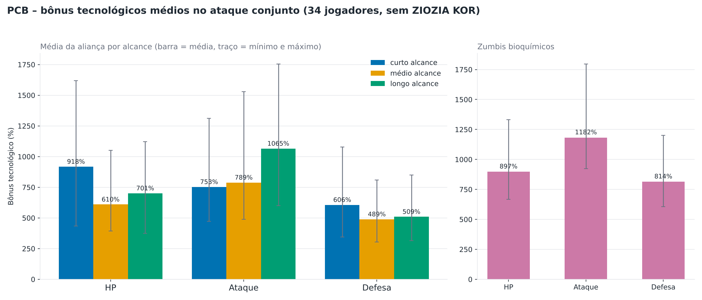
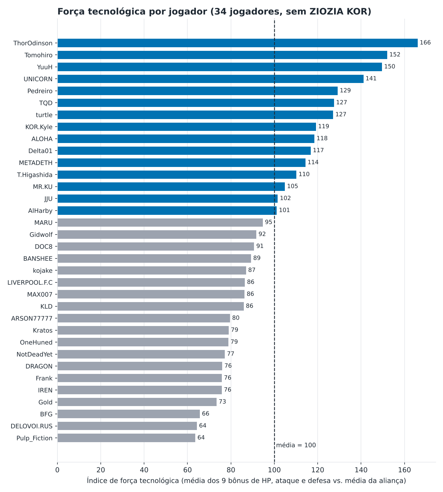
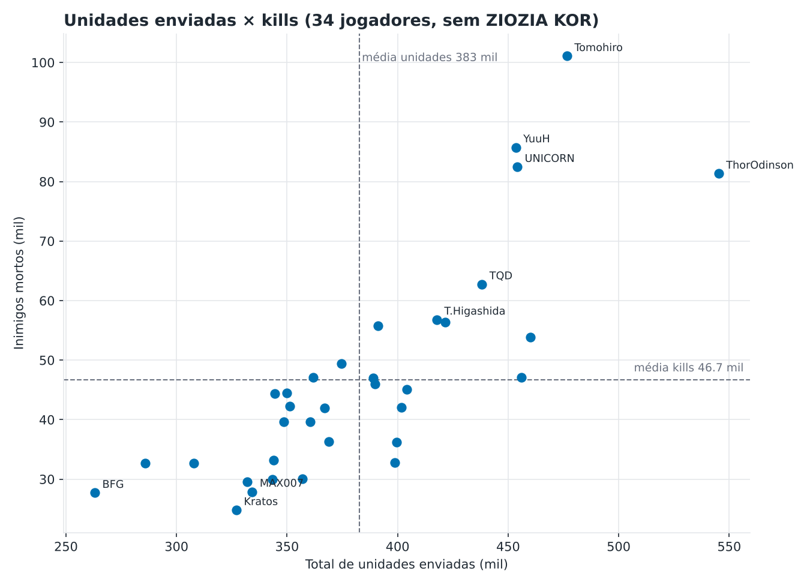

# PCB – ataque conjunto, sem ZIOZIA KOR (34 jogadores)

ZIOZIA KOR foi retirado de todas as médias a pedido. Dados e método iguais aos de `RELATORIO.md`.

## Ataque conjunto

| Estatística | Média | Mediana | Total |
|---|---:|---:|---:|
| Total de unidades | 382.850 | 371.780 | 13.016.904 |
| Matar inimigos | 46.650 | 43.322 | 1.586.109 |
| Sobreviventes | 181.571 | 176.316 | 6.173.416 |
| Unidades feridas | 201.279 | 195.464 | 6.843.488 |
| Perda de potência | 2.484.245 | 2.309.332 | 84.464.319 |

## Bônus tecnológicos

`Média (quem tem)` só entre jogadores com a linha; `Média da aliança` conta ausente como 0.

| Bônus tecnológico | Jogadores | Média (quem tem) | Média da aliança | Mediana | Mínimo | Máximo |
|---|---:|---:|---:|---:|---|---|
| HP de curto alcance | 34/34 | 917.6 | 917.6 | 843.4 | 433.9 (Pulp_Fiction) | 1618.0 (ThorOdinson) |
| HP de médio alcance | 34/34 | 609.7 | 609.7 | 549.2 | 393.1 (Pulp_Fiction) | 1050.5 (Tomohiro) |
| HP de longo alcance | 34/34 | 700.9 | 700.9 | 659.6 | 373.3 (DELOVOI.RUS) | 1120.9 (ThorOdinson) |
| Ataque de curto alcance | 34/34 | 752.6 | 752.6 | 694.8 | 472.3 (BFG) | 1310.5 (ThorOdinson) |
| Ataque de médio alcance | 34/34 | 788.6 | 788.6 | 724.0 | 488.2 (BFG) | 1529.5 (Tomohiro) |
| Ataque de longo alcance | 34/34 | 1065.1 | 1065.1 | 1041.2 | 599.5 (Pulp_Fiction) | 1753.5 (ThorOdinson) |
| Defesa de curto alcance | 34/34 | 606.5 | 606.5 | 531.5 | 345.2 (Pulp_Fiction) | 1078.4 (ThorOdinson) |
| Defesa de médio alcance | 34/34 | 489.1 | 489.1 | 446.1 | 304.5 (BFG) | 809.5 (ThorOdinson) |
| Defesa de longo alcance | 34/34 | 509.4 | 509.4 | 479.2 | 314.7 (DELOVOI.RUS) | 851.1 (ThorOdinson) |
| Aumento de dano contra unidades de longo alcance | 34/34 | 49.9 | 49.9 | 49.6 | 18.0 (Pulp_Fiction) | 87.1 (YuuH) |
| Aumento de dano contra unidades de médio alcance | 34/34 | 43.1 | 43.1 | 39.6 | 18.0 (Pulp_Fiction) | 81.2 (ThorOdinson) |
| Aumento de dano contra unidades de curto alcance | 34/34 | 47.2 | 47.2 | 42.0 | 18.0 (Pulp_Fiction) | 92.5 (UNICORN) |
| Redução de danos causados por unidades de longo alcance | 34/34 | 39.3 | 39.3 | 37.0 | 10.0 (Kratos) | 83.7 (UNICORN) |
| Redução de danos causados pelas Unidades de médio alcance | 34/34 | 37.9 | 37.9 | 37.0 | 10.0 (Kratos) | 74.9 (Tomohiro) |
| Redução de danos causados por unidades de curto alcance | 34/34 | 36.4 | 36.4 | 36.5 | 10.7 (MR.KU) | 60.2 (Tomohiro) |
| Aumento de ataque de zumbis bioquímicos | 34/34 | 1182.0 | 1182.0 | 1126.0 | 923.0 (BFG) | 1794.9 (ThorOdinson) |
| Aumento de HP de zumbis bioquímicos | 34/34 | 897.3 | 897.3 | 846.6 | 666.6 (DELOVOI.RUS) | 1332.3 (ThorOdinson) |
| Aumento da defesa dos zumbis bioquímicos | 34/34 | 814.0 | 814.0 | 770.2 | 606.4 (DELOVOI.RUS) | 1199.7 (ThorOdinson) |
| Bloqueio de Todas as Unidades | 34/34 | 118.3 | 118.3 | 72.7 | 9.3 (Pulp_Fiction) | 435.7 (Tomohiro) |
| Resistência à Supressão - Todas Unidades | 24/34 | 151.9 | 107.2 | 132.0 | 15.0 (MR.KU) | 429.0 (ThorOdinson) |
| Resistência à Interferência - Todas Unidades | 34/34 | 214.8 | 214.8 | 213.0 | 96.0 (IREN) | 390.0 (YuuH) |
| Aumentado para Ataques de curto alcance | 34/34 | 176.9 | 176.9 | 163.2 | 51.6 (Pulp_Fiction) | 354.3 (Tomohiro) |
| Aumentado para Ataque de médio alcance | 34/34 | 181.1 | 181.1 | 161.2 | 52.1 (Pulp_Fiction) | 421.3 (ThorOdinson) |
| Aumento de Ataque contra longo alcance | 34/34 | 182.1 | 182.1 | 148.9 | 58.0 (MAX007) | 422.0 (ThorOdinson) |
| Aumentado para Ataque de zumbis bioquímicos | 28/34 | 4.9 | 4.0 | 3.0 | 0.6 (IREN) | 25.2 (ThorOdinson) |
| Ataque de curto alcance do inimigo reduzido | 34/34 | 78.6 | 78.6 | 65.4 | 34.1 (MAX007) | 161.3 (Tomohiro) |
| Ataque de médio alcance do inimigo reduzido | 34/34 | 171.4 | 171.4 | 115.0 | 52.8 (Pulp_Fiction) | 481.9 (ThorOdinson) |
| Ataque de longo alcance do inimigo reduzido | 34/34 | 177.2 | 177.2 | 129.8 | 50.6 (Pulp_Fiction) | 452.6 (ThorOdinson) |
| Ataque de zumbi bioquímico inimigo reduzido | 34/34 | 54.0 | 54.0 | 45.2 | 26.8 (Gold) | 125.1 (ThorOdinson) |
| Defesa de curto alcance do inimigo reduzida | 34/34 | 17.7 | 17.7 | 18.4 | 1.4 (DELOVOI.RUS) | 39.2 (Tomohiro) |
| Defesa de médio alcance do inimigo reduzida | 34/34 | 10.1 | 10.1 | 9.8 | 1.4 (IREN) | 26.2 (Tomohiro) |
| Defesa de longo alcance do inimigo reduzida | 34/34 | 9.6 | 9.6 | 9.8 | 1.4 (KLD) | 51.2 (ThorOdinson) |
| Defesa dos zumbis bioquímicos do inimigo reduzida | 34/34 | 11.7 | 11.7 | 9.8 | 1.4 (IREN) | 64.6 (ThorOdinson) |
| Bônus de Ataque de Soldados | 34/34 | 84.1 | 84.1 | 78.0 | 46.0 (Frank) | 134.0 (Tomohiro) |
| Redução de dano recebido por Titãs | 34/34 | 10.2 | 10.2 | 7.0 | 4.5 (DRAGON) | 28.3 (YuuH) |
| HP Extra de Soldados | 34/34 | 230.1 | 230.1 | 212.0 | 152.0 (Frank) | 412.0 (ThorOdinson) |
| Inflexível - Dano de todas as unidades aumentado | 9/34 | 3.1 | 0.8 | 2.0 | 2.0 (turtle) | 6.0 (Pedreiro) |
| Tenacidade - Aumento de dano de todas as Unidades | 13/34 | 3.1 | 1.2 | 2.0 | 2.0 (ARSON77777) | 6.0 (Delta01) |
| Aumento de dano dos Titãs | 11/34 | 12.8 | 4.1 | 12.8 | 3.8 (MR.KU) | 22.4 (YuuH) |
| Defesa de curto alcance aprimorada | 1/34 | 12.8 | 0.4 | 12.8 | 12.8 (YuuH) | 12.8 (YuuH) |
| Defesa de médio alcance aprimorada | 2/34 | 9.4 | 0.6 | 9.4 | 2.1 (T.Higashida) | 16.8 (ThorOdinson) |

## Força por jogador

